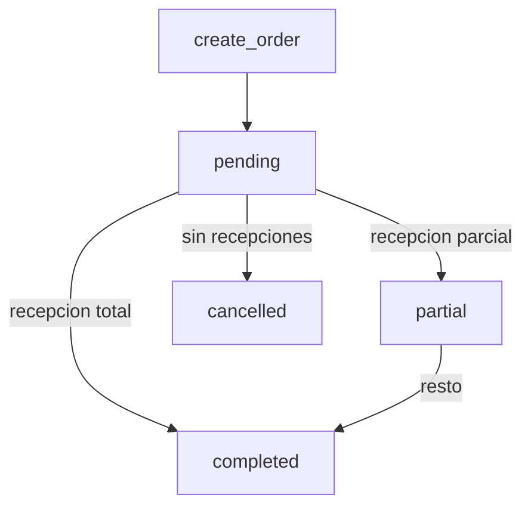
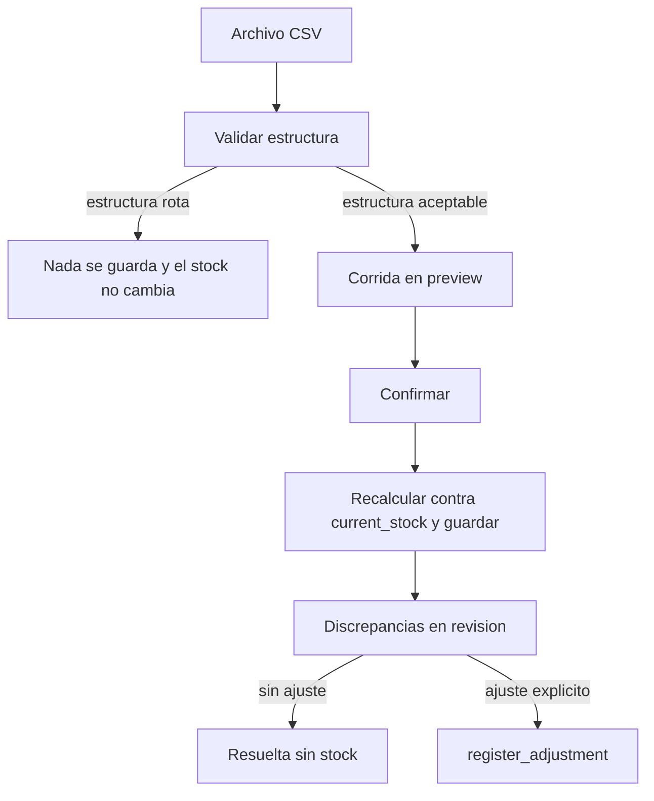

# Aprobación de compras y conciliación por corte

Implementación autorizada el 2026-09-28 con migraciones y pruebas en entornos aislados. No aplicar a `ferreteria_conejo_tesis` hasta que pasen todas las pruebas nuevas y de regresión, se presenten resultados y exista autorización expresa posterior. Sin commit/push/reset/restore/clean/stash, cambios DOCX/PDF ni resultados científicos. El ownership de ventas del vendedor queda fuera de alcance.

## 1. Cómo funciona hoy el flujo de compras

Las órdenes viven en `[app/models/purchase.py](app/models/purchase.py)`. No existe aprobación. El estado guardado solo tiene cuatro valores, con restricción `ck_po_status`:

- `pending` — etiqueta "Pendiente". Significa creada y aún recibible, no "pendiente de aprobación".
- `partial` — "Parcial".
- `completed` — "Completada".
- `cancelled` — "Cancelada".

Servicio: `[app/services/purchase_service.py](app/services/purchase_service.py)`.

- `create_order` fija `status="pending"`, `quantity_received=0` y **no llama a inventario**. Ignora `status` y `created_by_user_id` enviados por el cliente (`only(...)`).
- `receive_order` solo acepta `pending` o `partial`. Por cada cantidad llama `inventory_service.register_entry(..., commit=False)` y enlaza `PurchaseReceptionLine.stock_movement_id`. Después pone `partial` o `completed`.
- `cancel_order` solo si `pending` y ninguna unidad recibida. No mueve stock.
- `update_order` edita renglones solo en `pending`; en `partial` solo fecha y notas.

Trazabilidad que ya existe y se reutiliza:

- `created_by_user_id` y `created_at` en la orden.
- `received_by_user_id` y `received_at` en la recepción.

No existen `approved_by`, `approved_at`, `rejected_by`, `rejected_at` ni motivo de rechazo.

Rutas en `[app/routes/purchases.py](app/routes/purchases.py)`, todas con `permission_required` en servidor: `purchases:read|write|receive|cancel`. La UI está en `[app/templates/purchases/page.html](app/templates/purchases/page.html)` y `[app/static/js/ix_purchases.js](app/static/js/ix_purchases.js)`. Recepciones elegibles: `[reception_query_service.eligible](app/services/reception_query_service.py)` filtra `pending` y `partial`.

El reabastecimiento predictivo trata `pending` y `partial` como mercancía en camino (`SUPPLY_STATUSES` en `[app/services/replenishment_service.py](app/services/replenishment_service.py)`). Crear una orden desde ahí usa el mismo `create_order`.

## 2. Cómo funciona hoy la importación

La única importación real es la histórica de **demanda/ventas 2025**, CSV con `;`, no de existencias. `[app/services/historical_import_service.py](app/services/historical_import_service.py)` declara que no crea productos, no escribe movimientos y no modifica stock. El cruce es por `products.code` normalizado (`[historical_matching_service.py](app/services/historical_matching_service.py)`). El nombre no identifica el producto.

Excel no se importa. `openpyxl` solo exporta. La UI "Importar CSV" de productos es un aviso de que no está habilitada. No hay módulo de conciliación.

El stock operativo está en `products.current_stock` (no hay columna `sku`; el identificador es `code`). El camino trazable es `[app/services/inventory_service.py](app/services/inventory_service.py)`: `register_entry`, `register_exit` y `register_adjustment`. Este último fija un `new_stock`, exige motivo y **siempre hace commit**. No acepta `commit=False`, a diferencia de la entrada.

No hay Alembic. El esquema crece con scripts `scripts/migrate_*.py`. `[scripts/migrate_purchase_orders.py](scripts/migrate_purchase_orders.py)` solo acepta `ferreteria_conejo` y `ferreteria_conejo_e2e`, no la base de tesis.

## 3. Permisos que se reutilizan

Convención real: `modulo:accion` en `[app/utils/permissions.py](app/utils/permissions.py)`. Roles de sistema: `admin`, `inventario`, `vendedor`. No hay rol Compras.

Ya existen y se mantienen:

- `purchases:read`, `purchases:write` (crear y editar), `purchases:receive`, `purchases:cancel`.
- `inventory:move` para ajustes manuales.
- `historical_imports:*` queda aparte; no se reutiliza para conciliación.

Configuración base aprobada: Inventario recibe `purchases:read` y `purchases:write`, nunca `purchases:approve`. Administrador conserva lectura, escritura, recepción y cancelación, y recibe `purchases:approve` y `reconciliation:read|create|resolve`. La migración asigna también lectura/escritura a roles Inventario existentes. `ensure_seeded()` inserta permisos nuevos en el catálogo, pero **no los asigna a un rol admin que ya existe**. La asignación al admin tiene que ir en la migración SQL.

La separación creador/aprobador sí cabe sin cambiar el modelo de usuarios: `PurchaseOrder.created_by_user_id` ya guarda al solicitante. El servicio puede rechazar `current_user.id == created_by_user_id`. No hace falta un rol nuevo.

Límite operativo: con un solo usuario administrador que además crea la orden, esa orden no se puede aprobar. No se le dará `purchases:approve` a Inventario. Crear exige `purchases:write`, otorgado al admin y a Inventario; un rol personalizado puede recibir escritura sin aprobación.

## 4. Cambio mínimo de órdenes

Códigos en inglés, como el resto del sistema. Etiquetas en español.

Estados nuevos, sin borrar los actuales:

- `pending_approval` — "Pendiente de aprobación". Toda orden **nueva**.
- `approved` — "Aprobada". Único puente nuevo hacia la recepción.
- `rejected` — "Rechazada". Terminal.

Se conservan `pending`, `partial`, `completed`, `cancelled`. La etiqueta de `partial` pasa a "Parcialmente recibida". `pending` legado se muestra como "Pendiente (flujo anterior)": sigue siendo recibible porque así se cargó, y **no se reescribe**.

Transiciones que el servidor acepta, y ninguna otra:

- crear o duplicar → `pending_approval`
- `pending_approval` → `approved` | `rejected` | `cancelled`
- `approved` → `partial` | `completed` | `cancelled` (cancelar solo si no hay unidades recibidas)
- `pending` legado → `partial` | `completed` | `cancelled` (reglas actuales)
- `partial` → `completed` o se queda en `partial`
- `rejected`, `completed` y `cancelled` no se reciben, no se aprueban y no se reabren

Reglas de negocio en `purchase_service`, no en el frontend:

- Crear y aprobar no llaman a inventario.
- Recibir `pending_approval` o `rejected` responde 409.
- Recibir solo `approved`, `pending` legado o `partial`.
- Aprobar o rechazar exige `purchases:approve` y estado exacto `pending_approval`.
- Rechazar exige motivo no vacío, máximo 1000 caracteres.
- El creador no aprueba ni rechaza su orden (403).
- Repetir la decisión responde 409.
- El cuerpo JSON no puede fijar el estado; los endpoints dedicados lo hacen.
- Editar renglones solo en `pending_approval` y en `pending` legado. Una orden `approved` solo admite fecha y notas, igual que una parcial, para no alterar lo ya aprobado.

Campos nuevos, todos anulables, sin backfill:

- `approved_by_user_id`, `approved_at`
- `rejected_by_user_id`, `rejected_at`, `rejection_reason`

`created_by_user_id` y `created_at` no se duplican. `status` ya es `VARCHAR(20)` y `pending_approval` cabe (17).

`SUPPLY_STATUSES` y las recepciones elegibles pasan a `pending` legado + `approved` + `partial`. `pending_approval` y `rejected` no cuentan como mercancía en camino.

Interfaz, mismo shell de Compras:

- En `[app/templates/_ix_sidebar.html](app/templates/_ix_sidebar.html)`, hijo "Pendientes de aprobación" → `/purchases?status=pending_approval`.
- Filtro de estado en la página de órdenes.
- En el detalle: número, proveedor, fecha, solicitante, productos, cantidades, costos, total, notas, y la decisión con usuario y fecha.
- Botones Aprobar y Rechazar solo si hay permiso y el estado es `pending_approval`. Rechazar abre un motivo obligatorio. El API igual valida.

## 5. Órdenes existentes y migración

No se hace `UPDATE` de `status`. No hay `DROP` de base ni de tablas. No se reejecuta `[scripts/seed_tesis.py](scripts/seed_tesis.py)` contra MySQL.

El check actual solo permite los cuatro estados viejos, así que toda fila ya guardada es `pending`, `partial`, `completed` o `cancelled`. Esas filas siguen válidas al ampliar el `CHECK`. Las columnas nuevas quedan `NULL`: no hubo aprobador porque el flujo no existía.

Script nuevo, aditivo e idempotente, al estilo de `migrate_purchase_orders.py`, con `--database` obligatorio y lista blanca que **sí incluye** `ferreteria_conejo_tesis`, `ferreteria_conejo` y `ferreteria_conejo_e2e`:

- `ALTER` para soltar solo la restricción `ck_po_status` y crearla de nuevo con los siete estados.
- `ADD COLUMN` anulables e índices/FK a `users`.
- Catálogo y asignaciones idempotentes: admin recibe `purchases:read|write|approve|cancel` y `reconciliation:read|create|resolve`; Inventario recibe exclusivamente `purchases:read|write` de los permisos de compras nuevos. No se otorga aprobación a Inventario ni se alteran roles personalizados.

`[scripts/seed_tesis_safety.py](scripts/seed_tesis_safety.py)` no se toca. Su `validate_domain_schema` exige que las columnas de `purchase_orders` coincidan con el modelo. Por eso la migración tiene que aplicarse antes de cualquier seed futuro; el seed actual contra la base de tesis no se corre.

El generador sintético sí hay que ajustarlo en lo mínimo, porque `[scripts/test_seed_tesis.py](scripts/test_seed_tesis.py)` lo ejecuta en SQLite y hoy exige el conjunto `{pending, partial, completed, cancelled}`, y además llama `receive_order` justo después de crear. Mariana crea y recibe; Rafael es otro usuario. El ajuste: aprobar con Rafael solo las órdenes que el plan va a recibir, y dejar sin aprobar las que hoy quedan abiertas (`pending_approval`). La aserción de estados del test aislado se actualiza a ese conjunto. No cambian saldos, ventas, demanda ni elegibilidad predictiva. El propio seed dice que es sintético y no es evidencia empírica.

## 6. Módulo de conciliación

No se conecta a un sistema externo ni se reutiliza la importación histórica. CSV UTF-8 con `;`, límites de tamaño y de filas en el mismo espíritu que la importación histórica. XLSX no entra en esta entrega: `openpyxl` aquí solo exporta, y el importador histórico rechazó Excel a propósito.

Columnas: `product_code` obligatorio, `quantity` entera mayor o igual a cero, `product_name` opcional y solo informativo. El cruce es `products.code`, no el nombre.

Tablas nuevas:

- `reconciliation_runs`: número `CONC-######`, `cutoff_at` informado por el usuario, `imported_at`, nombre y SHA-256 del archivo, `created_by_user_id`, contadores (recibidos, válidos, rechazados, coincidencias, discrepancias, no identificados), estado del proceso `preview` | `confirmed` | `discarded`.
- `reconciliation_lines`: fila, código y nombre del archivo, `product_id` nulo si no existe, cantidad externa, cantidad del sistema, diferencia, resultado `invalid` | `unmatched` | `match` | `discrepancy`, mensaje de error.
- En la línea de discrepancia: `review_status` `pending` | `reviewed` | `resolved`; `reviewed_by_user_id`, `reviewed_at`, `review_note`; `resolved_by_user_id`, `resolved_at`, `resolution_note`, `resolution_action` (`acknowledge` o `adjustment`); `stock_movement_id` nulo.

Al confirmar se vuelven a leer los productos y se guarda la foto comparada. Confirmar no escribe `current_stock`. Un SKU inexistente queda `unmatched` y no es una discrepancia ajustable.

Resolver:

- `pending` → `reviewed` o `resolved`.
- `reviewed` → `resolved`.
- `resolved` no vuelve atrás.
- `acknowledge` no mueve stock y exige justificación.
- `adjustment` exige `new_stock` explícito y motivo. No copia solo la cifra externa. Llama a `register_adjustment` dentro de la misma transacción. Para eso se le añade `commit=False`, igual que `register_entry`, sin cambiar el comportamiento por defecto. Hace falta `reconciliation:resolve` y, solo en este caso, `inventory:move`.

Pantallas en el shell Pro, reutilizando el patrón visual de Compras: grupo Conciliación con Nueva conciliación, Historial y detalle de discrepancias. Permisos solo del admin en el mapa estático: `reconciliation:read`, `reconciliation:create`, `reconciliation:resolve`.

## 7. Archivos a tocar

Compras: modelo, `purchase_service`, `purchase_query_service`, `reception_query_service`, `replenishment_service`, controlador, rutas, `permissions.py`, sidebar, `page.html`, `ix_purchases.js`, CSS de badges, fixtures de `purchase_reference.py` si el modo `ref=1` lista estados, y los tests de compras/recepciones/predictivo que hoy reciben apenas crear.

Seed: solo `[scripts/seed_tesis.py](scripts/seed_tesis.py)` en el tramo compra/recepción/cancelación, y la aserción de estados en `[scripts/test_seed_tesis.py](scripts/test_seed_tesis.py)`. No `seed_tesis_safety.py`.

Conciliación: modelo nuevo, import en `[app/models/__init__.py](app/models/__init__.py)`, servicio, controlador, blueprint, registro en `[app/__init__.py](app/__init__.py)`, plantilla y JS, sidebar, `inventory_service.register_adjustment`, migración y `scripts/test_reconciliation_core.py`.

## 8. Riesgos de regresión

- Tests y el seed asumen crear y recibir en el acto. Hay que insertar la aprobación en esos flujos de prueba; si no, fallan con 409.
- El pronóstico de reabastecimiento dejaría de contar una orden nueva hasta que esté `approved`. Las `pending` ya guardadas siguen contando.
- KPI "Pendientes" y "próximas entregas" hoy miran `pending`. Hay que sumar `pending_approval` al conteo visible y `approved` a lo recibible, o las órdenes nuevas desaparecen del tablero.
- `ensure_seeded` no otorga el permiso nuevo a un admin ya creado. Sin la migración, el admin de la base viva recibe 403 al aprobar.
- Ampliar `register_adjustment` mal haría rollback de una transacción ajena. El default `commit=True` se conserva.
- Una FK nueva hacia `products` o `users` no debe impedir el reset del seed: las tablas de conciliación nacen vacías y el validador de referencias externas las revisa.
- No reejecutar el seed sobre `ferreteria_conejo_tesis`. El manifiesto ya cargado no debe regenerarse.

## 9. Pruebas

Suite nueva de compras en SQLite aislado. La suite existente `test_purchases_core.py` realmente usa MariaDB E2E y requiere revisar su aislamiento antes de ejecutarla: crear queda en `pending_approval` y el stock no cambia; sin `purchases:approve` no se aprueba; otro admin aprueba y el stock sigue igual; el creador recibe 403; rechazar sin motivo falla; rechazar guarda usuario, fecha y motivo; pendiente y rechazada no se reciben; aprobada sí, y ahí sí sube el stock vía movimiento; segunda aprobación y saltos de estado responden 409; una `pending` legada sigue pudiendo recibirse.

Suite nueva `scripts/test_reconciliation_core.py`: CSV válido se previsualiza; CSV inválido no escribe filas ni stock; SKU desconocido queda identificado; cantidades iguales son coincidencia; distintas son discrepancia; confirmar no cambia `current_stock`; resolver guarda usuario, fecha, justificación y acción; el ajuste crea `StockMovement` tipo `ajuste` y no escribe el stock por fuera del servicio; sin permiso, crear o resolver responde 403.

Después, la suite actual de compras, recepciones, seed aislado, predictivo e inventario, para ver regresiones. Esos scripts se lanzan con el Python del proyecto, no contra la base de tesis.

## 10. Etapas, después de tu autorización

1. Migración aditiva y permisos, sin ejecutarla todavía sobre la tesis hasta el paso de esquema acordado en esa misma etapa.
2. Servicio y API de aprobación, con tests de transición y stock.
3. Ajuste mínimo del generador sintético y de la aserción de estados, sin correrlo en MySQL.
4. UI de la cola y del detalle.
5. Modelo, servicio y API de conciliación, más `commit=False` en el ajuste.
6. UI de conciliación.
7. Ejecutar primero todas las pruebas nuevas y de regresión en entornos aislados; presentar resultados y limitaciones.
8. Detener la aplicación a `ferreteria_conejo_tesis` hasta recibir autorización expresa posterior del usuario. No reejecutar el seed en MySQL.
